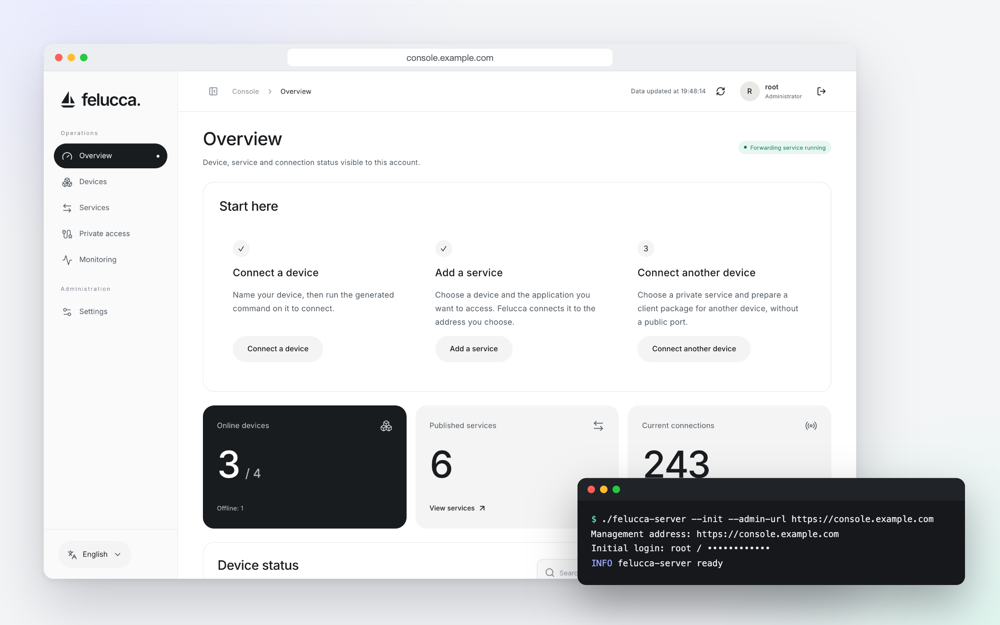
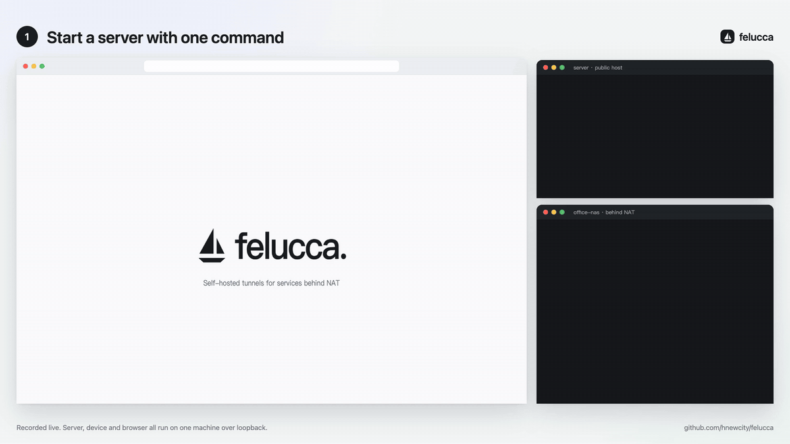
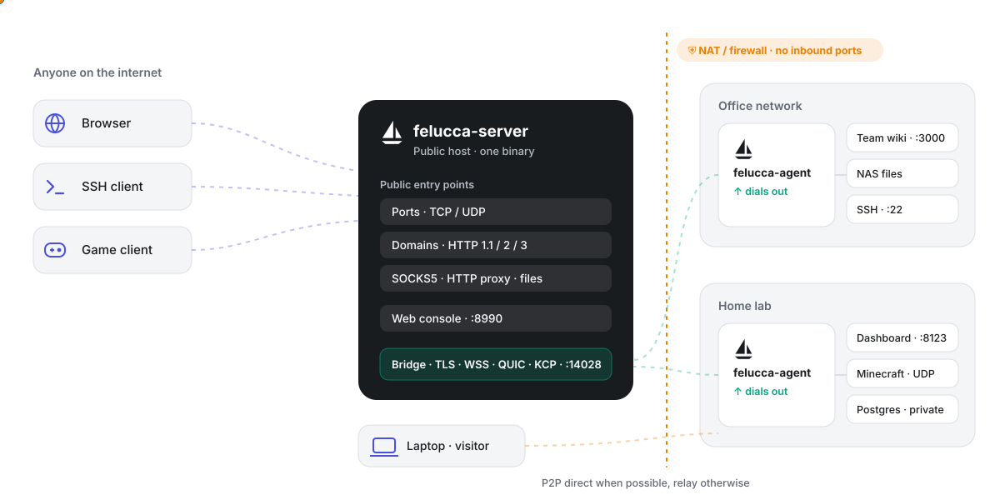
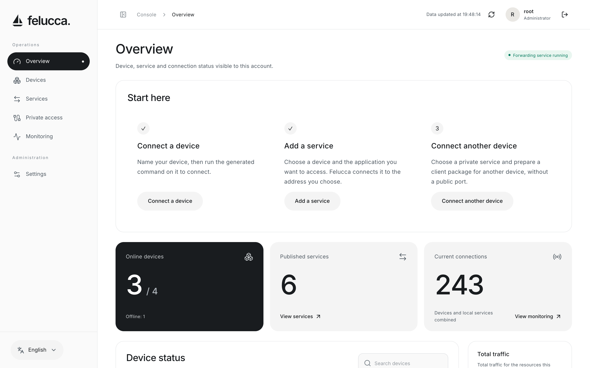
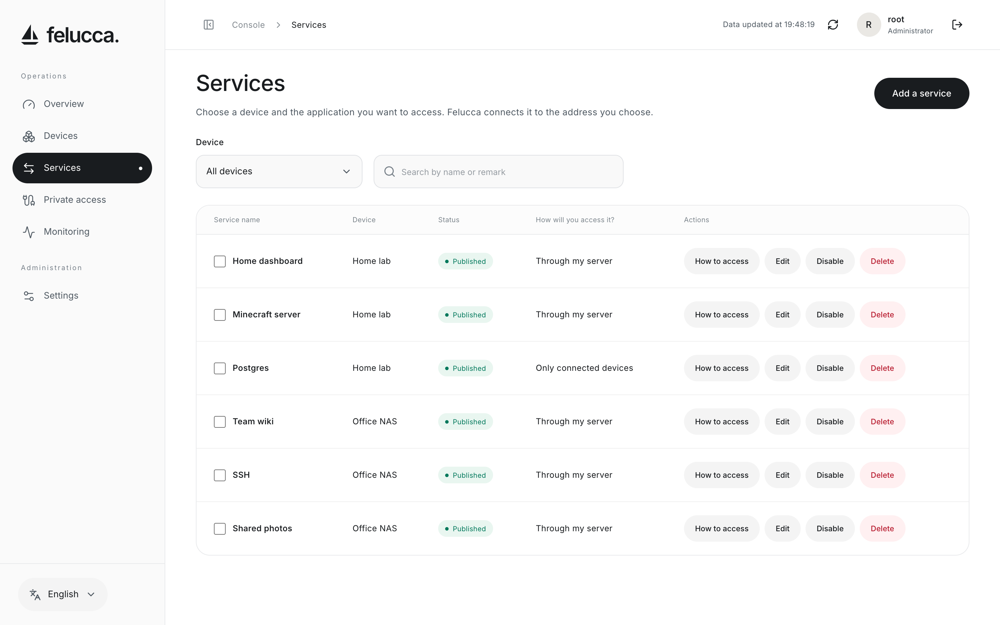
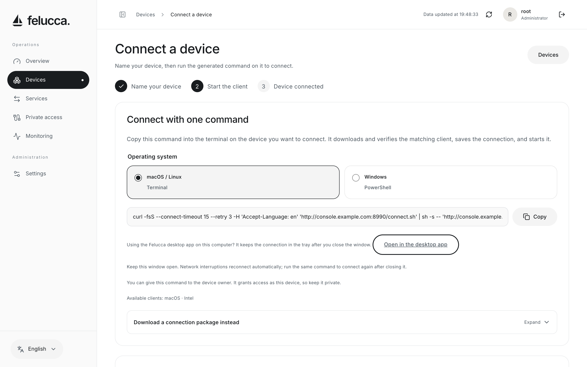
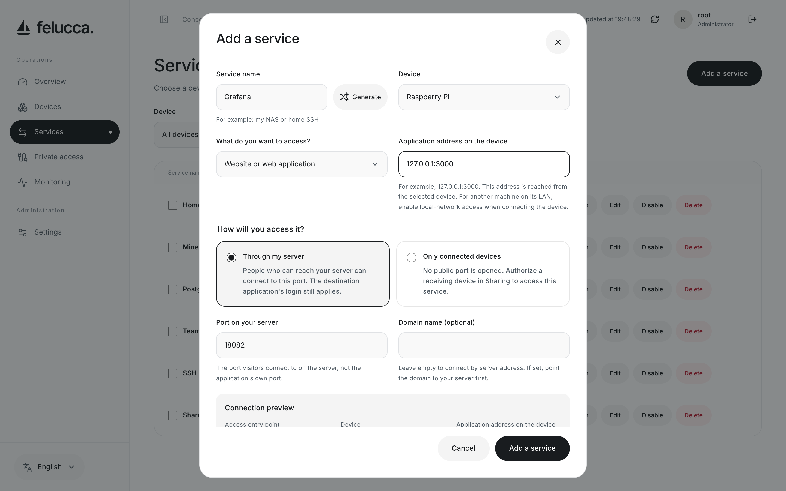
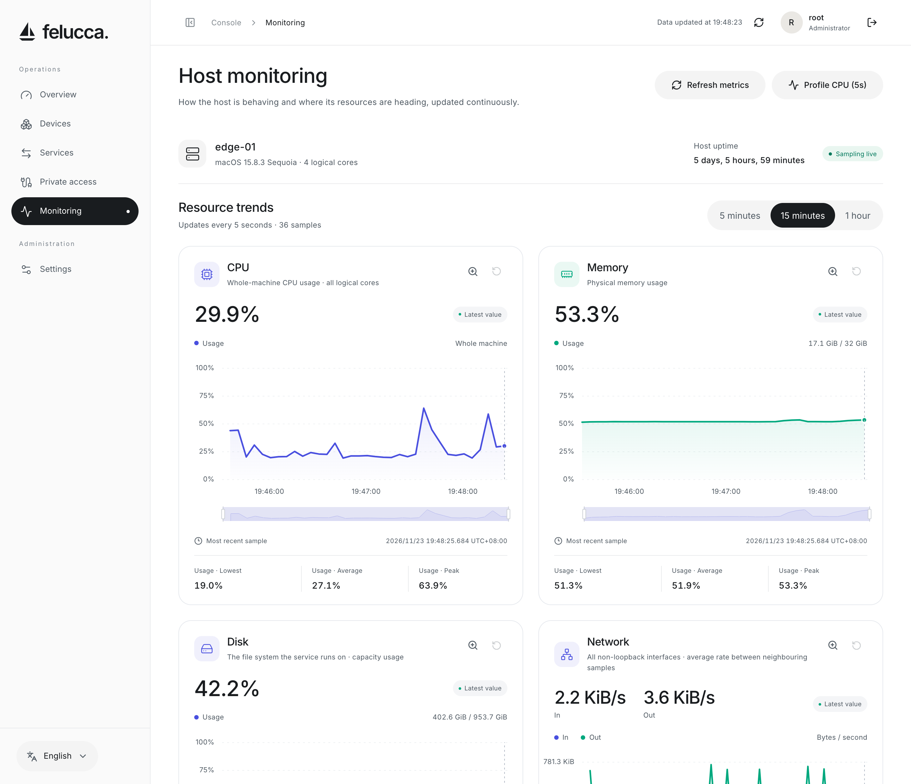
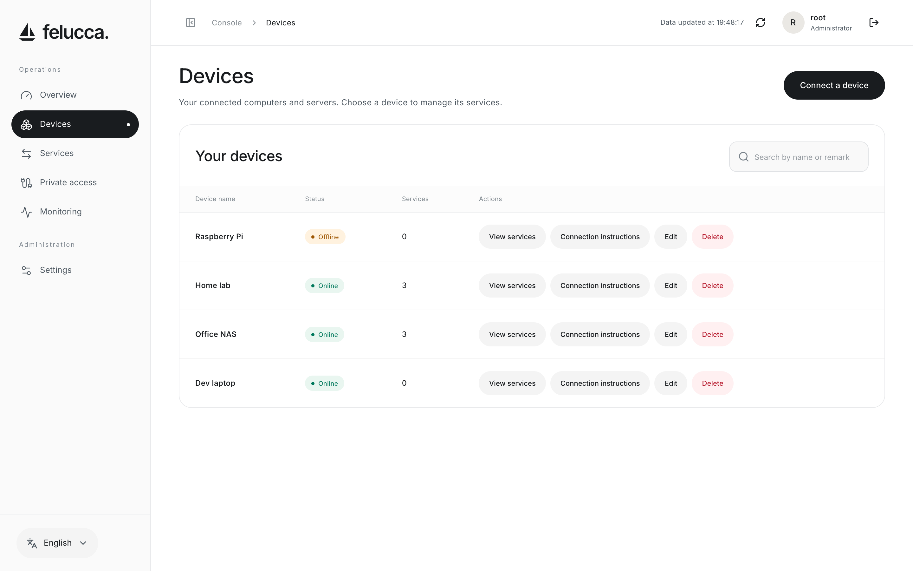

<p align="center">
  <picture>
    <source media="(prefers-color-scheme: dark)" srcset="docs/assets/logo-dark.png">
    
  </picture>
</p>

<p align="center">
  <strong>Reach services behind NAT through a server you own.</strong><br>
  One Rust binary on the public host, a web console, and a one-line command to connect each device.
</p>

<p align="center">
  <a href="https://github.com/hnewcity/felucca/releases/latest"></a>
  <a href="https://github.com/hnewcity/felucca/actions/workflows/check.yml"></a>
  <a href="https://github.com/hnewcity/felucca/pkgs/container/felucca-server"></a>
  
  <a href="LICENSE"></a>
</p>

<p align="center">
  <b>English</b> · <a href="README.zh-CN.md">简体中文</a>
  &nbsp;|&nbsp;
  <a href="#quick-start">Quick start</a> ·
  <a href="#see-it-in-action">Demo</a> ·
  <a href="docs/manual/en/README.md">Documentation</a> ·
  <a href="https://github.com/hnewcity/felucca/releases">Downloads</a>
</p>

<p align="center">
  
</p>

## What is Felucca?

Felucca puts a home server, an office NAS or a laptop behind NAT on the internet through a
public host you control. `felucca-agent` runs on the private machine and **dials out** to
`felucca-server`, so the private network needs no public IP, no router port mapping and no
firewall change. The server holds every public entry point: TCP and UDP ports, domains,
proxies and file shares.

Felucca is managed from a browser, not from config files. You start the server with one
command, name a device in the console, and paste the generated command on that device. The
command downloads the matching client and checks its SHA-256 before it starts it. You then
publish the device's applications from the console.

## See it in action

<p align="center">
  <a href="docs/assets/demo-en.mp4">
    
  </a>
  <br>
  <sub>Real recording, about 60 seconds. The server, the device and the browser all ran on one machine over loopback, and the final page came through the tunnel. <a href="docs/assets/demo-en.mp4">MP4 version</a></sub>
</p>

## Highlights

<table>
<tr>
<td width="50%" valign="top">

**One-line device onboarding**<br>
The console generates a `curl … | sh` or PowerShell command for each device. It picks the
right client for the CPU and OS, verifies its checksum and reconnects after network drops.
A tray app for macOS and Windows is also available.

</td>
<td width="50%" valign="top">

**A real web console**<br>
Devices, services, private access, accounts and live host monitoring, with admin, operator
and viewer roles. Changes reach devices without restarting other services. The UI is
available in English, 简体中文, 日本語, 한국어, Français, Español and Русский.

</td>
</tr>
<tr>
<td valign="top">

**Every kind of service**<br>
TCP and UDP forwarding, batch port mappings, an HTTP/HTTPS reverse proxy with domain and path
routing (HTTP/1.1, HTTP/2, HTTP/3, WebSocket), SOCKS5 and HTTP proxies, and file shares with
WebDAV.

</td>
<td valign="top">

**Private access without a public port**<br>
Share a service only with named devices. The receiving device opens a local port, the two
sides try a direct QUIC connection through UDP hole punching, and fall back to relaying
through the server.

</td>
</tr>
<tr>
<td valign="top">

**Transports for any network**<br>
TCP, TLS, WebSocket, WSS, QUIC and KCP (with 10+3 FEC by default) over one multiplexed bridge,
with flow control, backpressure and adaptive keepalive. TLS bridges pin the server
certificate, so you don't need a CA.

</td>
<td valign="top">

**Certificates and access control**<br>
ACME issuance and renewal (HTTP-01, TLS-ALPN-01, ZeroSSL EAB) and SNI routing. Source and
target ACLs with GeoIP and GeoSite, quotas, rate limits and per-tunnel ChaCha20-Poly1305
encryption.

</td>
</tr>
<tr>
<td valign="top">

**Built for operations**<br>
systemd, launchd and Windows service definitions, verified self-update, log rotation,
Prometheus metrics, CPU flame graphs and traffic counters that survive restarts.

</td>
<td valign="top">

**Easy to deploy**<br>
The admin UI is compiled into the server binary. Multi-arch container images for amd64 and
arm64. Release builds for Linux and macOS on x86_64 and ARM64, and for Windows on x86_64.

</td>
</tr>
</table>

<details>
<summary><b>Full feature list</b></summary>

| Area | What it does |
| --- | --- |
| Bridge transports | TCP, TLS, WebSocket, WSS, KCP (10+3 FEC by default); QUIC with native streams |
| Multiplexing | Window negotiation and growth, session and queue budgets, backpressure, half-close, RTT-adaptive keepalive, reconnect |
| Port forwarding | TCP/UDP, batch port mappings, PROXY v1/v2; UDP keeps datagram boundaries, empty packets and per-source isolation |
| HTTP/HTTPS reverse proxy | Domain, path and scheme routing; HTTP/1.1, 2 and 3; backend pooling; auth and rewrites; SNI certificates, passthrough or offload; streaming and upgrades |
| Forward proxy | SOCKS5 CONNECT and UDP ASSOCIATE, HTTP absolute-URL and CONNECT; mixed entry, multiple accounts, target ACLs |
| Backends | Multiple backends, TLS backends, round robin, weighted, least connections, source hash, failover |
| Health checks | TCP/TLS or HTTP probes; evict after consecutive failures, restore after consecutive successes |
| Server-local and nested targets | Services on the server itself; tunnel, file and bridge aliases; per-hop permissions; loop control up to 16 hops |
| File service | Directories on the server or the agent, WebDAV, read-only mode, multiple accounts, Range downloads, directory confinement |
| ACME | HTTP-01 and TLS-ALPN-01, EAB and ZeroSSL API keys, persisted accounts and certificates, renewal before expiry, hot reload |
| Private shares | TCP/UDP/file services with no public port, mutual shared-key authentication, local SOCKS CONNECT/UDP visitors |
| P2P | One-time tickets, UDP address discovery and hole punching, pinned-certificate QUIC direct links, relay fallback, quotas on both sides |
| External platforms | Multi-platform permissions, reverse WSS RPC, signed callbacks, durable queue with replay, traffic import, node sync |
| Operations | Service definitions and commands, verified updates, log rotation, Prometheus, CPU sampling, Docker and CI builds |
| Management | Browser console, tenant permissions, API and batch operations, persistence and rollback, config push, SSE updates |
| Startup configuration | TOML/JSON, remote config with bearer auth, base64 and launch URIs, environment variables, multiple agent instances |
| Egress | Custom DNS with TTL cache, source IP, HTTP CONNECT and SOCKS5 upstream proxies, NTP-corrected auth clock |
| Stream coding | Optional per-tunnel Snappy compression and independent ChaCha20-Poly1305 encryption, keeping half-close and UDP boundaries |
| Access and limits | GeoIP/GeoSite, L4 source ACLs, quotas per user, client, tunnel and domain, rate and connection limits, traffic snapshots |

</details>

## How it works

<p align="center">
  <picture>
    <source media="(prefers-color-scheme: dark)" srcset="docs/assets/architecture-en-dark.svg">
    
  </picture>
</p>

1. Each agent opens one long-lived, multiplexed **bridge** connection to the server
   (TCP port 14028 by default; QUIC and KCP can be enabled on their own UDP ports).
2. A visitor connects to a port or domain on the server. The server checks the source ACL,
   quotas and connection limits, then opens a stream to the matching agent.
3. The agent picks a healthy backend and connects to the local application. Bytes flow both
   ways until either side closes, and the server meters the traffic.

The [architecture guide](docs/manual/en/architecture.md) covers the concepts in detail.

## Quick start

### 1. Start the server

Download a release for your public host, then initialize it once in a writable directory:

```sh
./felucca-server --init --admin-url https://console.example.com
```

```text
Management address: https://console.example.com
Initial login: root / <random password>
```

The command writes `felucca-server.toml`, prints a random root password and starts the
server. Later starts only need `./felucca-server`. Keep the `felucca-server.data/` directory
when you upgrade or back up.

An `https://` address means the console sits behind your HTTPS reverse proxy, which forwards
to `127.0.0.1:8990` and keeps the Host header. An `http://<public-ip>:8990` address makes the
server listen on that port directly. Devices need to reach the bridge on TCP **14028**, and
visitors need to reach the ports you publish.

<details>
<summary><b>With Docker</b></summary>

The image runs as UID 10001 and keeps its state in `/data`. Initialize once, write down the
login it prints, and press <kbd>Ctrl</kbd>+<kbd>C</kbd>:

```sh
docker run --rm -it -v felucca:/data ghcr.io/hnewcity/felucca-server:0.1.0 \
  --init --config /data/server.toml --admin-url https://console.example.com
```

Then run it for good. Host networking lets ports you publish later work without remapping:

```sh
docker run -d --name felucca --restart unless-stopped --network host \
  -v felucca:/data ghcr.io/hnewcity/felucca-server:0.1.0 --config /data/server.toml
```

Without host networking, as on Docker Desktop, initialize with `--admin-url http://<host-ip>:8990`
so the console listens on all interfaces inside the container. Then publish `8990`, `14028`
and each service port with `-p` instead of `--network host`.

</details>

### 2. Connect a device

Open the console, sign in, and choose **Devices → Connect a device**. Name the device and copy
the generated command:

```sh
curl -fsS … 'https://console.example.com/connect.sh' | sh -s -- …
```

Run it on the machine behind NAT, or use the PowerShell variant on Windows. Keep the window
open; the device reconnects by itself after network drops. The command carries the device's
credentials, so give it only to the device owner.

### 3. Publish a service

Choose **Add a service**, pick the device and enter the application's local address, for
example `127.0.0.1:3000`. Pick **Through my server** and a port to publish it, or **Only
connected devices** to keep it private. The service is reachable as soon as its status reads
**Published**.

> **Just want to look around?** `python3 scripts/demo-local.py` builds everything and starts a
> server, an agent and a sample website on loopback, then opens the console.

## Screenshots

<table>
<tr>
<td width="50%"><p align="center"><sub>Overview: devices, services and traffic at a glance</sub></p></td>
<td width="50%"><p align="center"><sub>Services published from every device</sub></p></td>
</tr>
<tr>
<td><p align="center"><sub>Connect a device with one command</sub></p></td>
<td><p align="center"><sub>Add a service in one dialog</sub></p></td>
</tr>
<tr>
<td><p align="center"><sub>Live host monitoring and CPU profiling</sub></p></td>
<td><p align="center"><sub>Device status and connection instructions</sub></p></td>
</tr>
</table>

## Install

### Release downloads

Each [release](https://github.com/hnewcity/felucca/releases) includes:

| File | Contents |
| --- | --- |
| `felucca-<version>-<target>-release.tar.gz` / `.zip` | `felucca-server` and `felucca-agent` with docs and examples, for Linux (x86_64, aarch64), macOS (x86_64, aarch64) and Windows (x86_64) |
| `felucca-agents.tar.gz` | Agents for every platform, so one server can onboard any device |
| `Felucca_<version>_aarch64.dmg`, `…_x64-setup.exe`, `…_x64_*.msi` | Desktop tray app for macOS and Windows (not yet code-signed) |
| `SHA256SUMS` | Checksums for every file |

### Container images

```sh
docker pull ghcr.io/hnewcity/felucca-server:0.1.0
docker pull ghcr.io/hnewcity/felucca-agent:0.1.0
```

Both are published for `linux/amd64` and `linux/arm64` and tagged `latest`, `<major>.<minor>`
and `<version>`.

### Build from source

You need Rust 1.88 or later and Node.js 22.12 or later (24 recommended). The console is built
first and then compiled into the server binary.

```sh
npm --prefix apps/admin ci
npm --prefix apps/admin run build
cargo build --release --locked -p felucca-cli --bins
# target/release/felucca-server and target/release/felucca-agent
```

## Documentation

The [user manual](docs/manual/en/README.md) covers configuration, every module and a full
reference. It is available in
[English](docs/manual/en/README.md) · [中文](docs/manual/zh/README.md) ·
[日本語](docs/manual/ja/README.md) · [한국어](docs/manual/ko/README.md) ·
[Français](docs/manual/fr/README.md) · [Español](docs/manual/es/README.md) ·
[Русский](docs/manual/ru/README.md).

| Start here | Then |
| --- | --- |
| [Get started](docs/manual/en/get-started.md) | [Tunnels and port mappings](docs/manual/en/tunnels.md) |
| [Architecture and concepts](docs/manual/en/architecture.md) | [HTTP/HTTPS reverse proxy](docs/manual/en/http-services.md) |
| [Configuration and CLI](docs/manual/en/configuration.md) | [Private shares](docs/manual/en/private-shares.md) · [P2P](docs/manual/en/p2p.md) |
| [Admin console](docs/manual/en/management.md) | [Operations and monitoring](docs/manual/en/operations.md) |

Configuration examples for every feature live in [`examples/`](examples).

## Status

Felucca 0.1.0 is the first public release. The bridge protocol is at version 10; **upgrade
the server and its agents together**. Every pull request runs the test suite on Linux, macOS
and Windows. Real-world NAT traversal rates, public CA issuance and service installation are
not yet covered by tests; test them in your own environment.

Felucca started as a from-scratch reimplementation of the feature set of
[nps](https://github.com/djylb/nps). It speaks its own protocol and is **not compatible**
with nps or npc.

## Contributing

Issues and pull requests are welcome. Read [CONTRIBUTING.md](CONTRIBUTING.md) for the build,
test and lint commands, and [docs/architecture.md](docs/architecture.md) for where each
module lives.

## License

[Apache License 2.0](LICENSE)
