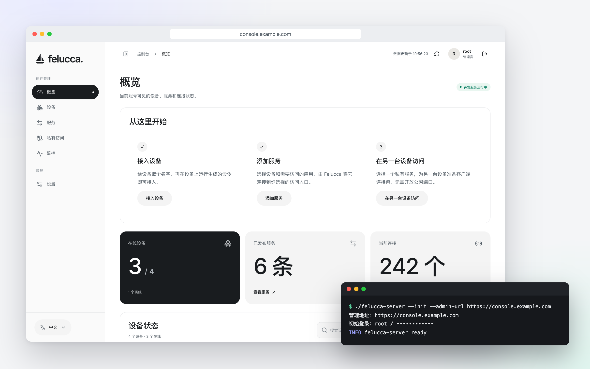
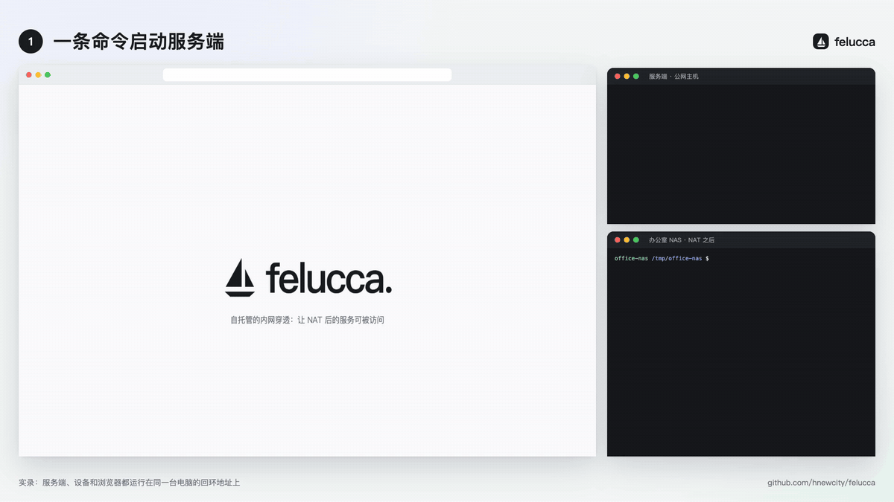
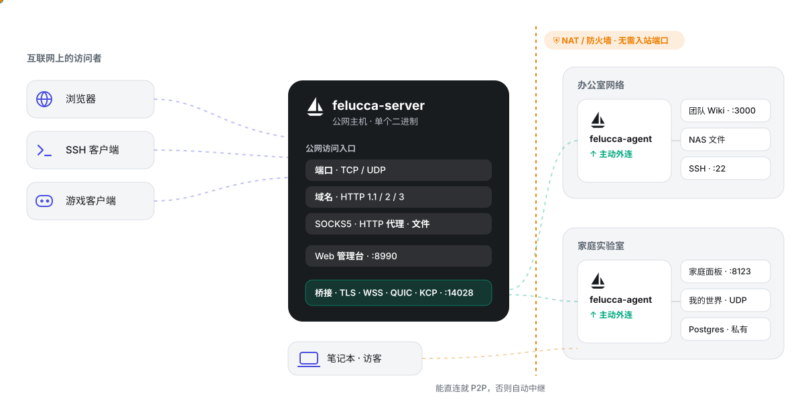
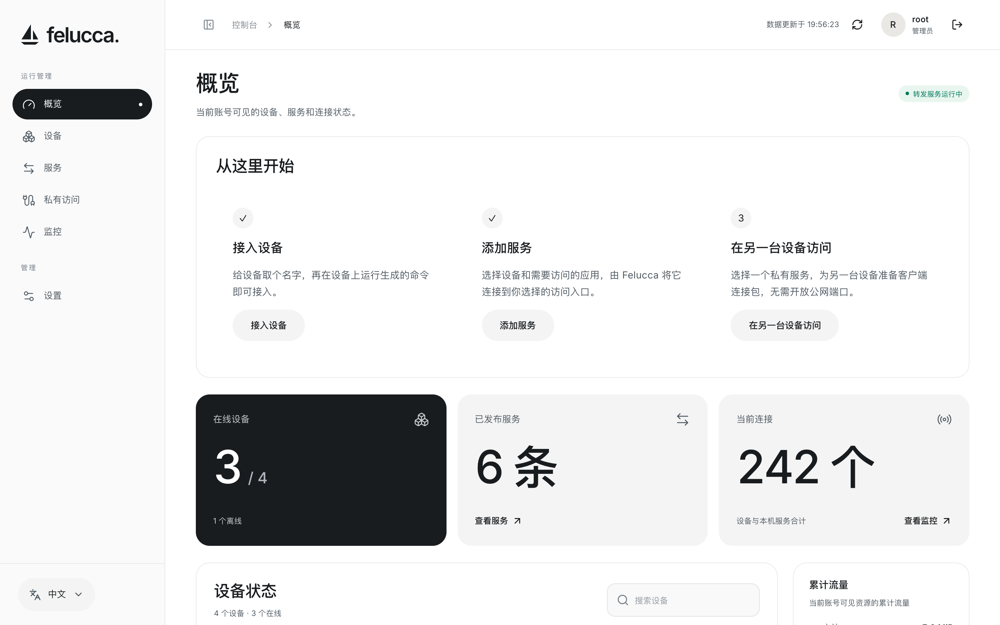
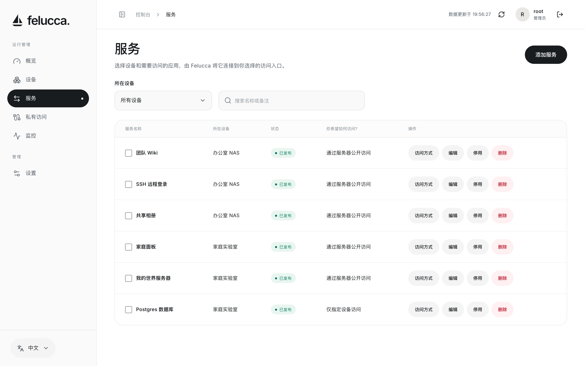
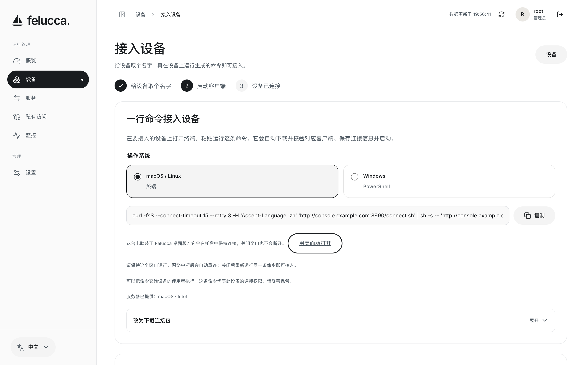
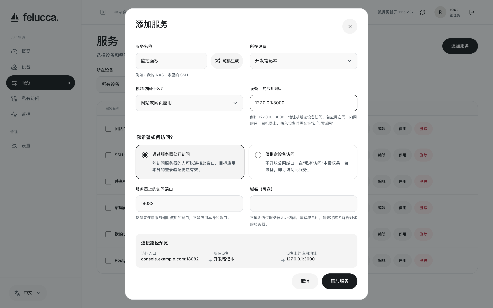
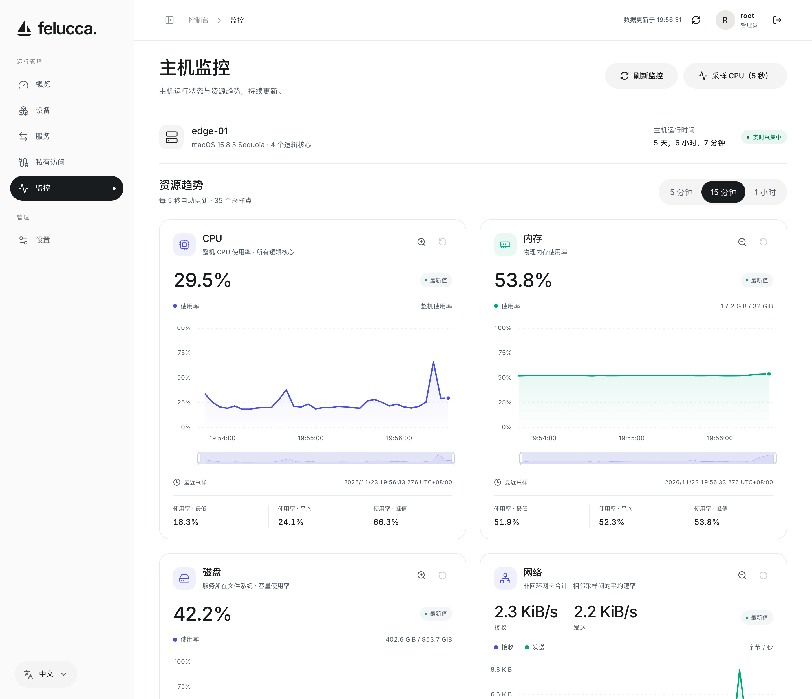
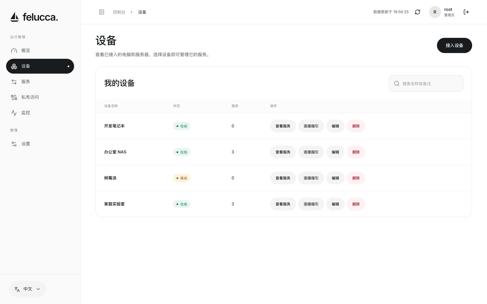

<p align="center">
  <picture>
    <source media="(prefers-color-scheme: dark)" srcset="docs/assets/logo-dark.png">
    
  </picture>
</p>

<p align="center">
  <strong>通过你自己的服务器，访问 NAT 后面的服务。</strong><br>
  公网主机上只跑一个 Rust 程序，配一个网页管理台，每台设备一行命令接入。
</p>

<p align="center">
  <a href="https://github.com/hnewcity/felucca/releases/latest"></a>
  <a href="https://github.com/hnewcity/felucca/actions/workflows/check.yml"></a>
  <a href="https://github.com/hnewcity/felucca/pkgs/container/felucca-server"></a>
  
  <a href="LICENSE"></a>
</p>

<p align="center">
  <a href="README.md">English</a> · <b>简体中文</b>
  &nbsp;|&nbsp;
  <a href="#快速开始">快速开始</a> ·
  <a href="#演示">演示</a> ·
  <a href="docs/manual/zh/README.md">文档</a> ·
  <a href="https://github.com/hnewcity/felucca/releases">下载</a>
</p>

<p align="center">
  
</p>

## Felucca 是什么

Felucca 让家里的服务器、办公室的 NAS 或者 NAT 后面的笔记本，通过一台你自己掌控的公网主机
对外提供服务。`felucca-agent` 运行在内网机器上，**主动连接**公网的 `felucca-server`，
所以内网不需要公网 IP，不需要在路由器上做端口映射，也不需要改防火墙。所有公网入口都在服务端：
TCP 和 UDP 端口、域名、代理和文件共享。

日常管理在浏览器里完成，不需要手写配置文件。一条命令启动服务端；在管理台给设备起个名字，
把生成的命令粘贴到那台设备上运行。命令会下载匹配的客户端，校验 SHA-256 后再启动。
之后在管理台发布这台设备上的应用即可。

## 演示

<p align="center">
  <a href="docs/assets/demo-zh.mp4">
    
  </a>
  <br>
  <sub>真实录屏，约 60 秒。服务端、设备和浏览器都运行在同一台电脑的回环地址上，最后打开的页面确实经过了隧道。<a href="docs/assets/demo-zh.mp4">MP4 版本</a></sub>
</p>

## 亮点

<table>
<tr>
<td width="50%" valign="top">

**一行命令接入设备**<br>
管理台为每台设备生成 `curl … | sh` 或 PowerShell 命令，自动按 CPU 和系统选择客户端、
校验校验和，断网后自动重连。也提供 macOS 和 Windows 的托盘客户端。

</td>
<td width="50%" valign="top">

**完整的网页管理台**<br>
设备、服务、私有访问、账号和实时主机监控，支持管理员、操作员、只读三种角色。
修改会直接同步到设备，不影响其他服务的连接。界面支持中文、English、日本語、
한국어、Français、Español 和 Русский。

</td>
</tr>
<tr>
<td valign="top">

**各种服务都能发布**<br>
TCP 和 UDP 转发、批量端口映射、按域名和路径路由的 HTTP/HTTPS 反向代理
（HTTP/1.1、HTTP/2、HTTP/3、WebSocket）、SOCKS5 和 HTTP 代理，以及支持 WebDAV 的文件共享。

</td>
<td valign="top">

**不开公网端口的私有访问**<br>
只把服务共享给指定的设备。接收方在本机打开一个端口，双方先尝试 UDP 打洞建立 QUIC 直连，
打不通时自动改由服务端中继。

</td>
</tr>
<tr>
<td valign="top">

**适应各种网络的传输**<br>
TCP、TLS、WebSocket、WSS、QUIC 和 KCP（默认 10+3 FEC），统一走多路复用的桥接连接，
带流控、背压和自适应保活。TLS 桥接固定服务端证书指纹，不需要 CA。

</td>
<td valign="top">

**证书与访问控制**<br>
ACME 签发和自动续期（HTTP-01、TLS-ALPN-01、ZeroSSL EAB）以及 SNI 路由。
支持 GeoIP / GeoSite 的来源和目标 ACL、配额、限速，以及每条隧道独立的 ChaCha20-Poly1305 加密。

</td>
</tr>
<tr>
<td valign="top">

**为运维而做**<br>
systemd、launchd 和 Windows 服务定义，带校验的自更新，日志轮转，Prometheus 指标，
CPU 火焰图，流量计数在重启后保留。

</td>
<td valign="top">

**部署简单**<br>
管理台编译进服务端二进制。提供 amd64 和 arm64 多架构容器镜像。
发行包覆盖 x86_64 和 ARM64 的 Linux、macOS，以及 x86_64 的 Windows。

</td>
</tr>
</table>

<details>
<summary><b>完整功能列表</b></summary>

| 功能 | 行为 |
| --- | --- |
| 隧道传输 | TCP、TLS、WebSocket、WSS、KCP（默认 10+3 FEC）；QUIC 使用原生多路流 |
| 多路复用 | 窗口协商和增长、会话与队列预算、背压、半关闭、RTT 自适应保活、断线重连 |
| 端口转发 | TCP/UDP、批量端口映射、PROXY v1/v2；UDP 保留报文边界、空包及来源隔离 |
| HTTP/HTTPS 反向代理 | 域名/路径/协议路由、HTTP/1.1/2/3、后端连接池、认证与重写、SNI 证书/直通/卸载、流式传输与升级 |
| 正向代理 | SOCKS5 CONNECT/UDP ASSOCIATE、HTTP 绝对 URL/CONNECT；混合入口、多账号认证和目标 ACL |
| 后端 | 多后端、TLS 后端、轮询、加权、最少连接、来源哈希、主备切换 |
| 健康检查 | TCP/TLS 或 HTTP 探测，连续失败摘除、连续成功恢复 |
| 本地与嵌套目标 | 服务端本地服务、tunnel/file/bridge 别名、逐跳权限和最多 16 跳环路控制 |
| 文件服务 | server 或 agent 本地目录、WebDAV、只读控制、多账号认证、Range 下载、目录边界保护 |
| ACME | HTTP-01 / TLS-ALPN-01、EAB/ZeroSSL API、账户和证书持久化、到期前续期、证书热替换 |
| 私有共享 | 无公开端口的 TCP/UDP/文件服务、双向共享密钥认证、本地 SOCKS CONNECT/UDP 访客 |
| P2P | 一次性票据、UDP 地址观察与打洞、固定证书 QUIC 直连、失败回落中继、双端配额与计量 |
| 外部平台管理 | 多平台权限、反向 WSS RPC、签名回调、持久队列与重放、流量导入、节点同步 |
| 运维 | 系统服务定义与命令、校验更新、日志轮转、Prometheus、CPU 采样、Docker/CI 构建 |
| 管理与集中配置 | 浏览器管理、租户权限、API/批量操作、持久化与回滚、远端下发、SSE 更新通知 |
| 启动配置 | TOML/JSON、远程配置与 Bearer 鉴权、base64/启动 URI、环境变量、多 agent 实例 |
| 网络出口 | 自定义 DNS、TTL 缓存、出口 IP、HTTP CONNECT/SOCKS5 上游代理、认证时钟 NTP 校准 |
| 数据流编码 | 每条隧道可选 Snappy 压缩、独立 ChaCha20-Poly1305 加密；保留半关闭和 UDP 边界 |
| 访问与限制 | GeoIP/GeoSite、四层来源 ACL、用户/客户端/隧道/域名配额、限速和连接数、流量快照 |

</details>

## 工作原理

<p align="center">
  <picture>
    <source media="(prefers-color-scheme: dark)" srcset="docs/assets/architecture-zh-dark.svg">
    
  </picture>
</p>

1. 每个 agent 与服务端保持一条长连接、可多路复用的**桥接**
   （默认 TCP 14028 端口；QUIC 和 KCP 可以在各自的 UDP 端口上另行启用）。
2. 访问者连接服务端的某个端口或域名。服务端检查来源 ACL、配额和连接数后，
   向对应的 agent 打开一条流。
3. agent 选出一个健康的后端，连接本地应用。数据双向传输，直到任意一方关闭；服务端负责计量流量。

各个概念的详细说明见[架构与概念](docs/manual/zh/architecture.md)。

## 快速开始

### 1. 启动服务端

在公网主机上下载发行包，在一个可写目录里初始化一次：

```sh
./felucca-server --init --admin-url https://console.example.com
```

```text
管理地址：https://console.example.com
初始登录：root / <随机密码>
```

这条命令会生成 `felucca-server.toml`，打印随机的 root 密码并启动服务端。
以后启动只需要 `./felucca-server`。升级或备份时保留 `felucca-server.data/` 目录。

`https://` 地址表示管理台放在你的 HTTPS 反向代理后面，由代理转发到 `127.0.0.1:8990`
并保留 Host 头。填 `http://<公网 IP>:8990` 则由服务端直接监听这个端口。
设备需要能连到桥接端口 TCP **14028**，访问者需要能连到你发布的端口。

<details>
<summary><b>使用 Docker</b></summary>

镜像以 UID 10001 运行，状态保存在 `/data`。先初始化一次，记下打印出的登录信息，
然后按 <kbd>Ctrl</kbd>+<kbd>C</kbd> 退出：

```sh
docker run --rm -it -v felucca:/data ghcr.io/hnewcity/felucca-server:0.1.0 \
  --init --config /data/server.toml --admin-url https://console.example.com
```

再以常驻方式运行。使用主机网络，之后发布的端口不需要再做映射：

```sh
docker run -d --name felucca --restart unless-stopped --network host \
  -v felucca:/data ghcr.io/hnewcity/felucca-server:0.1.0 --config /data/server.toml
```

如果没有主机网络（例如 Docker Desktop），初始化时改用 `--admin-url http://<主机 IP>:8990`，
让管理台在容器内监听所有网卡；再用 `-p` 映射 `8990`、`14028` 和各个服务端口，代替 `--network host`。

</details>

### 2. 接入设备

打开管理台并登录，选择 **设备 → 接入设备**。给设备起个名字，复制生成的命令：

```sh
curl -fsS … 'https://console.example.com/connect.sh' | sh -s -- …
```

在 NAT 后面的机器上运行它，Windows 上用 PowerShell 版本。保持窗口打开，断网后会自动重连。
命令里包含这台设备的凭据，只交给设备的使用者。

### 3. 发布服务

选择 **添加服务**，选好设备，填写应用在本机的地址，例如 `127.0.0.1:3000`。
选 **通过服务器公开访问** 并指定端口即可对外发布；选 **仅指定设备访问** 则只对授权的设备开放。
状态变为 **已发布** 后就可以访问了。

> **只想先看看？** 运行 `python3 scripts/demo-local.py`，它会构建全部组件，在回环地址上启动
> 服务端、agent 和一个示例网站，然后打开管理台。

## 截图

<table>
<tr>
<td width="50%"><p align="center"><sub>概览：设备、服务和流量一目了然</sub></p></td>
<td width="50%"><p align="center"><sub>所有设备上发布的服务</sub></p></td>
</tr>
<tr>
<td><p align="center"><sub>一行命令接入设备</sub></p></td>
<td><p align="center"><sub>一个对话框添加服务</sub></p></td>
</tr>
<tr>
<td><p align="center"><sub>实时主机监控和 CPU 采样</sub></p></td>
<td><p align="center"><sub>设备状态和接入说明</sub></p></td>
</tr>
</table>

## 安装

### 发行包

每个 [Release](https://github.com/hnewcity/felucca/releases) 包含：

| 文件 | 内容 |
| --- | --- |
| `felucca-<版本>-<目标平台>-release.tar.gz` / `.zip` | `felucca-server` 和 `felucca-agent`，附文档和示例；覆盖 Linux（x86_64、aarch64）、macOS（x86_64、aarch64）和 Windows（x86_64） |
| `felucca-agents.tar.gz` | 全平台 agent 合集，一台服务端即可接入任意平台的设备 |
| `Felucca_<版本>_aarch64.dmg`、`…_x64-setup.exe`、`…_x64_*.msi` | macOS 和 Windows 的桌面托盘客户端（暂未签名） |
| `SHA256SUMS` | 所有文件的校验和 |

### 容器镜像

```sh
docker pull ghcr.io/hnewcity/felucca-server:0.1.0
docker pull ghcr.io/hnewcity/felucca-agent:0.1.0
```

两个镜像都提供 `linux/amd64` 和 `linux/arm64`，标签有 `latest`、`<主版本>.<次版本>` 和 `<版本号>`。

### 从源码构建

需要 Rust 1.88 或更新版本，以及 Node.js 22.12 或更新版本（推荐 24）。先构建管理台，
再把它编译进服务端二进制：

```sh
npm --prefix apps/admin ci
npm --prefix apps/admin run build
cargo build --release --locked -p felucca-cli --bins
# 产物：target/release/felucca-server 和 target/release/felucca-agent
```

## 文档

[用户手册](docs/manual/zh/README.md)包含配置方法、每个模块的用法和完整参考，提供
[中文](docs/manual/zh/README.md) · [English](docs/manual/en/README.md) ·
[日本語](docs/manual/ja/README.md) · [한국어](docs/manual/ko/README.md) ·
[Français](docs/manual/fr/README.md) · [Español](docs/manual/es/README.md) ·
[Русский](docs/manual/ru/README.md) 七种语言。

| 从这里开始 | 然后 |
| --- | --- |
| [快速上手](docs/manual/zh/get-started.md) | [隧道与端口映射](docs/manual/zh/tunnels.md) |
| [架构与概念](docs/manual/zh/architecture.md) | [HTTP/HTTPS 反向代理](docs/manual/zh/http-services.md) |
| [配置来源与命令行](docs/manual/zh/configuration.md) | [私有共享](docs/manual/zh/private-shares.md) · [P2P](docs/manual/zh/p2p.md) |
| [管理台](docs/manual/zh/management.md) | [运维与监控](docs/manual/zh/operations.md) |

每个功能的配置示例都在 [`examples/`](examples) 目录。

## 项目状态

Felucca 0.1.0 是第一个公开版本。桥接协议当前为第 10 版，**服务端和 agent 需要一起升级**。
每个 Pull Request 都会在 Linux、macOS 和 Windows 上运行完整测试。真实公网环境下的 NAT
穿透成功率、公共 CA 签发和系统服务安装还没有测试覆盖，请在自己的环境中验证。

Felucca 最初参考 [nps](https://github.com/djylb/nps) 的功能范围从零实现，使用自己的通信协议，
**不兼容** nps/npc。

## 参与贡献

欢迎提交 Issue 和 Pull Request。构建、测试和检查命令见 [CONTRIBUTING.md](CONTRIBUTING.md)，
各模块的职责划分见 [docs/architecture.md](docs/architecture.md)。

## 许可证

[Apache License 2.0](LICENSE)
